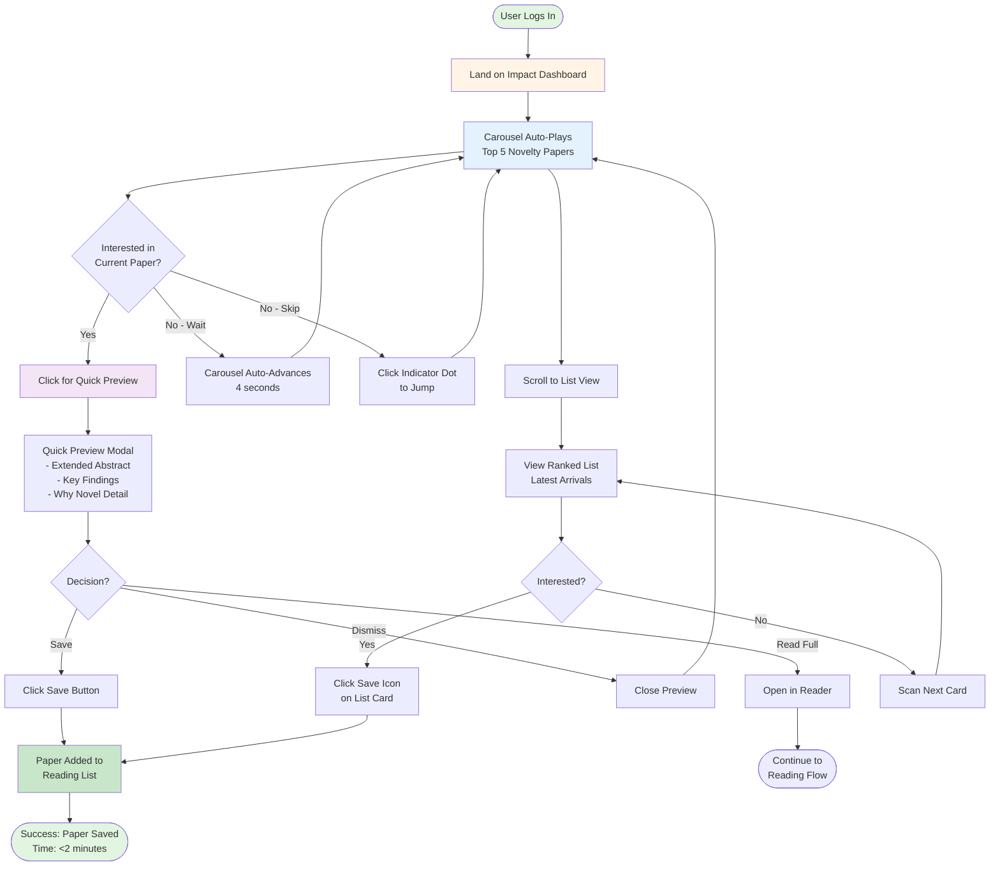
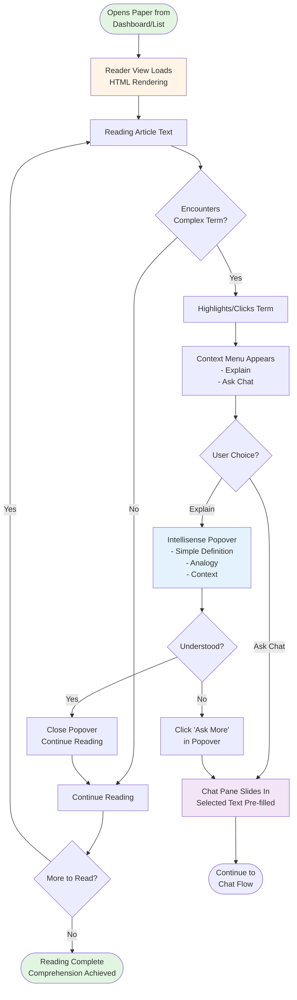
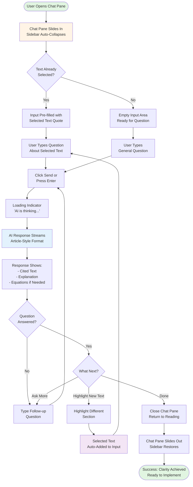

# UX Design Specification Sphere

**Author:** SFerrum
**Date:** 2025-12-31

---

<!-- UX design content will be appended sequentially through collaborative workflow steps -->

## Executive Summary

### Project Vision

Sphere is an "Intellectual Augmentation" tool designed to democratize access to complex knowledge. Unlike traditional reference managers that focus on storage, Sphere focuses on *comprehension*. It leverages LLMs to filter for "Novelty" and provides an "Interactive Learning Layer" that acts as an on-demand tutor, simplifying complex concepts directly within the reading experience.

### Target Users

1.  **The Knowledge Hunter (Dr. Aris):** Post-doc researcher under pressure. Needs rapid triage. Values "Novelty" and efficiency.
2.  **The Lifelong Learner (Sarah):** Senior Engineer exploring new fields. Needs deep comprehension. Values "Clarity" and "Actionable Insight."

### Key Design Challenges

1.  **Visualizing "Novelty":** The interface must communicate *why* a paper is novel (the "Intellectual Delta") at a glance, without cluttering the dashboard.
2.  **Seamless "Intellisense":** The "Click-to-Explain" overlay must feel like an organic part of the text, minimizing context switching. It must handle latency gracefully.
3.  **Chat Pane Integration:** The "Chat with Paper" pane must coexist with the reading view without cramping the text, ensuring a fluid dialogue alongside deep reading.

### Design Opportunities

-   **"Living Text":** Use subtle interactive cues (hover states) on technical terms to hint at the "Intellisense" capability, encouraging exploration.
-   **Calm Triage:** Utilize generous whitespace and clear typography on the Dashboard to counter "Research Overload" anxiety.

## Core User Experience

### Defining Experience

The core experience centers on **"Fluid Contextual Inquiry."** The user seamlessly transitions between reading (passive) and inquiring (active) without losing their place. The interface adapts its primary affordances based on the user's mode: "Reading Mode" prioritizes quick definitions (Intellisense), while "Deep Dive Mode" (Chat Pane open) prioritizes complex dialogue.

### Platform Strategy

-   **Desktop:** The primary "Deep Work" surface. Supports a split-view (Text + Chat) interaction model.
-   **Mobile:** Focused on Triage and "Light Reading" (Intellisense only, simplified Chat).
-   **Interaction Model:** Mouse/Touch hybrid. Highlighting text is the primary trigger for all context actions.

### Effortless Interactions

-   **Smart Context Carry-Over:** Highlighting text while the Chat Pane is open *automatically* quotes that text in the chat input, ready for a question. No copy-paste required.
-   **Adaptive Context Menu:**
    -   *Pane Closed:* Primary action = "Explain" (Intellisense).
    -   *Pane Open:* Primary action = "Ask Chat" (Add to Prompt).
-   **Swipe-to-Summon:** The Chat Pane is hidden by default to preserve focus but swipes in effortlessly from the right when needed.

### Critical Success Moments

-   **The "Aha!" Moment:** When a user highlights a confusing paragraph, asks the Chat Assistant "Can you explain this?", and gets an answer that *specifically references* the highlighted text.
-   **The Flow Preservation:** Being able to ask a question and return to reading without losing scroll position or visual context.

### Experience Principles

1.  **Context is King:** The system always knows what the user is looking at. The LLM is pre-loaded with the full paper context.
2.  **Mode-Aware Affordances:** The UI anticipates the user's intent (Quick Definition vs. Deep Question) based on the interface state (Pane Closed vs. Open).
3.  **Visual Citation:** Direct quotes from the text must be visually distinct in the chat interface to separate "Source Truth" from "User Query."

## Desired Emotional Response

### Primary Emotional Goals

**"Intellectual Confidence."** The user should transition from feeling *overwhelmed* by information density to feeling *empowered* and *capable*, as if they have a genius tutor guiding them.

### Emotional Journey Mapping

1.  **Discovery (Dashboard):** *Relief.* "I don't have to read 50 papers. I only need these 3."
2.  **Reading (Intellisense):** *Curiosity.* "I'm not afraid of this jargon anymore. I can just click it."
3.  **Inquiry (Chat Pane):** *Mastery.* "I can ask deep questions and get answers cited from the text."

### Micro-Emotions

-   **Trust:** Generated when the Chat Assistant visually cites its sources.
-   **Flow:** Generated when the Chat Pane slides in without obscuring the text or requiring a page reload.
-   **Clarity:** Generated when a complex equation is explained with a simple analogy.

### Design Implications

-   **No "Black Boxes":** Always show *why* (Novelty Score breakdown, Citation links) to build trust.
-   **Calm UI:** Use "Academic Minimalist" aesthetics—generous whitespace, serif fonts, muted colors—to counter the anxiety of information overload.
-   **Optimistic Feedback:** Immediate visual response to clicks (even before the LLM replies) to maintain the feeling of control.

### Emotional Design Principles

1.  **Empower, Don't Overwhelm:** Every feature should make the user feel smarter, not more confused.
2.  **Calm by Default:** The interface should be a quiet space for deep thought, not a noisy dashboard.
3.  **Transparent Magic:** AI features should feel magical but explainable.

## UX Pattern Analysis & Inspiration

### Inspiring Products Analysis

1.  **Linear (Project Management):**
    *   *Why:* Masters "Calm Density." Allows managing hundreds of items without anxiety.
    *   *Lesson:* Use keyboard-first triage and "Inbox Zero" workflows for the Impact Dashboard.

2.  **Medium (Reader View):**
    *   *Why:* The gold standard for distraction-free reading on the web.
    *   *Lesson:* Use a "Floating Action Menu" on text selection for the "Explain/Chat" toggle, keeping the UI invisible until needed.

3.  **Cursor (AI Code Editor):**
    *   *Why:* Seamlessly blends "Editor" and "Chat" with deep context awareness.
    *   *Lesson:* Adopt the "Context Pill" pattern—showing exactly what file/lines are in the prompt—to build trust in the Chat Pane.

### Transferable UX Patterns

-   **Keyboard Triage:** `E` to Archive/Dismiss, `S` to Save. (From Linear)
-   **Contextual Float:** Highlighting text triggers a minimal menu near the cursor. (From Medium)
-   **Context Pills:** Visual indicators in the chat input showing "Referencing: Paragraph 3." (From Cursor)

### Anti-Patterns to Avoid

-   **The "PDF Viewer" Trap:** Embedding a raw PDF iframe feels static and "dead." We must render HTML.
-   **The "Chatbot Overlay":** A generic floating bubble in the corner feels like customer support. The chat must be a first-class pane.

### Design Inspiration Strategy

**Strategy:** "Linear for the List, Medium for the Text, Cursor for the Brain."
We will adopt Linear's efficiency for the dashboard, Medium's typography for the reading experience, and Cursor's interaction model for the AI integration.

## Design System Foundation

### Design System Choice

**Shadcn/UI** (Radix Primitives + Tailwind CSS).

### Rationale for Selection

1.  **Speed & Control:** Offers the speed of pre-built components (Dialogs, Popovers) with the control of copy-paste code, allowing us to implement our "Academic Minimalist" aesthetic without fighting framework overrides.
2.  **Performance:** Built on headless Radix primitives, ensuring maximum performance and accessibility with minimal bundle size impact (< 1s load time goal).
3.  **Next.js Native:** The de-facto standard for modern Next.js applications, ensuring seamless integration with our chosen stack.

### Implementation Approach

-   **Base:** Install Shadcn/UI with a "Slate" or "Neutral" base color to match the academic vibe.
-   **Typography:** Configure `Inter` (sans) for UI and `Merriweather` or `Newsreader` (serif) for the Reader view.
-   **Icons:** Use `Lucide React` for clean, consistent iconography.

### Customization Strategy

-   **Radius:** Set to `0.3rem` for a slightly softer but professional look.
-   **Dark Mode:** First-class citizen. The "Reader" view must support a high-contrast "OLED Black" and a softer "Sepia" mode.

## Core User Experience Details

### Defining Experience

The **"Contextual Inquiry" Loop**: The seamless transition from *consuming* information to *interrogating* it. The user highlights text to trigger an immediate, context-aware interaction (Explain or Ask) without leaving the reading flow.

### User Mental Model

-   **Current Model:** Disconnected. "Highlight -> Copy -> Switch Tab -> Paste -> Prompt." High friction.
-   **New Model:** Direct Manipulation. "Point -> Click -> Understand." Zero friction. The system anticipates the need for explanation.

### Success Criteria

1.  **Zero-Latency Feel:** The context menu must appear instantly (0ms perceived delay) upon selection.
2.  **Context Preservation:** The user never loses their scroll position or visual context of the original text.
3.  **Source Trust:** The chat response must clearly and visually quote the source text to bridge the gap between "AI Answer" and "Source Truth."

### Novel UX Patterns

-   **"Swipe-to-Summon" Chat:** Instead of a permanent sidebar or a floating bubble, the chat pane is a "drawer" that slides in only when needed, maximizing reading real estate.
-   **"Smart Quote" Input:** Highlighting text while the chat pane is open *automatically* populates the input field with a visual blockquote of the selection, signaling "I am asking about *this*."

### Experience Mechanics

**1. Initiation:**
-   User selects text in the Reader view.
-   **System Response:** A minimal, pill-shaped menu appears immediately above the selection.

**2. Interaction:**
-   **Option A (Explain):** User clicks "Explain." A popover appears *pointing* to the text with a 1-sentence definition.
-   **Option B (Ask):** User clicks "Ask." The Chat Pane slides in from the right. The selected text is already added as a "Context Block" in the input area.

**3. Feedback:**
-   **Visual:** The selected text remains highlighted (in a distinct color) to show what is being discussed.
-   **Conversational:** The AI response starts with "Regarding [concept]..." to confirm understanding.

**4. Completion:**
-   User clicks outside the popover/pane or presses `Esc`.
-   **System Response:** UI dismisses, highlight fades, user returns to pure reading mode.

## Visual Design Foundation

### Color System

**"Academic Slate" Palette**
-   **Primary:** `Slate-900` (#0f172a) - Used for primary text and high-emphasis actions. Deep, professional, high-contrast.
-   **Accent:** `Indigo-600` (#4f46e5) - Used for the "Novelty Score," links, and primary buttons. Intellectual, calm, not "salesy."
-   **Backgrounds:**
    -   *Dashboard:* `Slate-50` (#f8fafc) - Slightly off-white to reduce glare.
    -   *Paper:* `White` (#ffffff) - Classic paper feel.
    -   *Dark Mode:* `Slate-950` (#020617) - "OLED Black" for deep focus.

### Typography System

**"The Modern Scholar" Pairing**
-   **UI Font (Sans):** `Inter`. Clean, legible, invisible. Used for the Dashboard, Menus, Chat Pane, and Metadata.
-   **Reader Font (Serif):** `Merriweather` or `Newsreader`. Optimized for long-form reading on screens. High x-height, excellent readability.

### Spacing & Layout Foundation

-   **Density:** "Relaxed."
-   **Base Unit:** `4px`.
-   **Default Padding:** `16px` (p-4) is the standard unit to create "Calm."
-   **Grid:** Single-column (max-width 65ch) for the Reader. Masonry or Grid (auto-fit) for the Dashboard.

### Accessibility Considerations

-   **Contrast:** All text must meet WCAG AA standards (4.5:1). `Slate-500` is the lightest gray allowed for text.
-   **Focus States:** All interactive elements (Impact Cards, Buttons) must have visible focus rings for keyboard navigation (crucial for the "Linear-style" triage).

## Design Direction

### Selected Direction: Academic Minimalist

**Decision Date:** 2025-12-31  
**Rationale:** The Academic Minimalist direction best embodies the "Intellectual Confidence" emotional goal while supporting both rapid triage (Dashboard) and deep comprehension (Reader). The design balances visual sophistication with functional clarity, using Material Design 3 patterns for the carousel and Overleaf-inspired split-screen for the reading experience.

### Dashboard Design

#### Top 5 Novelty Carousel

**Pattern:** Material Design 3 Multi-Browse Carousel  
**Behavior:**
- **Auto-Rotation:** Cycles through top 5 papers every 4 seconds
- **Infinite Loop:** Seamlessly wraps from paper #5 back to #1
- **Center Focus:** One card is always centered and fully visible
- **Distance-Based Fade:** 
  - Focused card: 100% opacity, scale(1), full brightness
  - Adjacent cards: 60% opacity, scale(0.85), 70% brightness
  - Far cards: 30% opacity, scale(0.7), 50% brightness
- **Interactive Indicators:** Clickable dots to jump to specific papers
- **Spacing:** 24px gap between cards

**Card Content:**
- Novelty score badge (top-left)
- Ranking indicator (top-right)
- Paper title (2xl, bold)
- Brief abstract (1-2 lines)
- **"Why Novel?" section:** Unique insight explaining the intellectual delta, separated by border-top

**Visual Style:**
- Gradient background: `from-indigo-600 to-indigo-700`
- White text for maximum contrast
- Rounded corners: `rounded-2xl`
- Shadow: `shadow-2xl` for depth

#### Ranked List View

**Pattern:** Horizontal list cards ranked by novelty  
**Layout:**
- Wide, rectangular cards (full container width)
- Novelty score: Left-aligned, large (xl), bold, indigo-600
- Content: Center-aligned, truncated title with metadata
- Action: Right-aligned chevron (visible on hover)

**Metadata Display:**
- Authors (medium weight, slate-700)
- Venue and year (slate-500)
- Category tag (slate-100 background, slate-600 text)

**Interaction:**
- Hover: Border changes to indigo-300, shadow appears
- Click: Navigates to Reader view

### Reader View Design

#### Split-Screen Layout (Overleaf-Style)

**Core Principle:** The chat pane "squeezes" the article content rather than overlaying it, preserving readability and context.

**Default State:**
- Sidebar: Visible (256px width)
- Article: Full width
- Chat Pane: Hidden (0px width)

**Chat Open State:**
- Sidebar: Collapsed (0px width, 0px padding)
- Sidebar Toggle: Visible as overlay button (top-left)
- Article: Flexible width (adjusts based on chat pane width)
- Chat Pane: 50% of viewport width (default)
- Resizer Handle: Visible between article and chat pane

**Resizer Interaction:**
- Visual: 4px wide, transparent by default
- Hover: Indigo-500 background
- Drag: Column-resize cursor, real-time width adjustment
- Constraints: Min 300px for both article and chat pane

**Chat Pane Toggle:**
- **Collapsed State:** Sticky button on right edge (pointing left `<`)
- **Open State:** Chevron on resizer handle (pointing right `>`)
- **Animation:** 300ms ease-in-out transition

#### Chat Pane Content

**Header:**
- Title: "Chat with Paper" (sm, semibold)
- Close button: X icon (slate-400, hover: slate-900)

**Message Area:**
- User queries: Subtle, left-bordered, slate-400
- AI responses: Article-style typography
  - Headers: Serif, bold, lg
  - Body: Relaxed leading, slate-700
  - Equations: Centered, bordered, white background
  - Code: Mono font, xs

**Input Area:**
- Height: 33vh (1/3 of viewport)
- Textarea: Full height, resizable
- Send button: Floating (bottom-right), indigo-600, rounded-full
- Hints: Bottom row, xs, slate-400 ("Markdown supported", "Enter to send")

### Typography Hierarchy

**Dashboard:**
- Section headers: xs, bold, uppercase, slate-400, tracking-wider
- Card titles: 2xl (carousel), base (list), bold, semibold
- Metadata: xs, slate-500

**Reader:**
- Article title: 3xl-4xl, bold, slate-900, tracking-tight
- Authors: sm, slate-500
- Body text: lg, serif (Merriweather), slate-800, leading-relaxed
- Interactive terms: indigo-50 background, indigo-900 text, border-bottom

### Color Application

**Backgrounds:**
- Dashboard: slate-50
- Article: white
- Chat Pane: slate-50
- Sidebar: white

**Borders:**
- Default: slate-200
- Hover: indigo-300
- Active: indigo-600

**Interactive States:**
- Hover: Text changes to indigo-600
- Focus: 2px indigo-500 ring
- Active: indigo-600 background (buttons)

### Accessibility Features

- All interactive elements have visible focus states
- Keyboard navigation: Tab through carousel indicators, list items
- ARIA labels on icon-only buttons
- Color contrast meets WCAG AA (4.5:1 minimum)
- Resizer handle has adequate hit target (12px including hover zone)

### Responsive Behavior

**Desktop (>1024px):**
- Full split-screen capability
- Carousel shows 3 cards simultaneously (center + adjacent)

**Tablet (768px-1024px):**
- Chat pane opens at 60% width
- Carousel shows 2 cards

**Mobile (<768px):**
- Chat pane opens full-screen
- Carousel shows 1 card at a time
- Sidebar becomes overlay by default

## User Journey Flows

### Rapid Triage Flow (Dr. Aris)

**Journey Goal:** Find and save high-novelty papers in <2 minutes

**Entry Point:** User logs in and lands directly on Impact Dashboard

**Flow Overview:**
1. Dashboard loads with auto-playing carousel showing Top 5 Novelty papers
2. User passively scans carousel as it auto-advances every 4 seconds
3. When interested, user clicks carousel card to open Quick Preview modal
4. Preview shows extended abstract, key findings, and detailed "Why Novel?" explanation
5. User decides to Save (adds to Reading List), Read Full (opens Reader), or Dismiss
6. User can also scroll to Ranked List view and save directly from list cards
7. Success: Paper saved in <2 minutes

**Flow Diagram:**

**Key Optimizations:**
- **Zero Friction Entry:** No home screen - lands directly on dashboard
- **Passive Discovery:** Carousel auto-plays, allowing passive scanning
- **Quick Decision Points:** Save/Dismiss available at multiple touchpoints (carousel preview and list cards)
- **Progressive Disclosure:** Quick Preview provides more context without full commitment to reading

**Error Recovery:**
- If no papers available: Dashboard shows "Check back tomorrow" message
- If carousel fails to load: Falls back to list view only
- If save fails: Shows retry button with error message

---

### Deep Interactive Reading Flow (Sarah)

**Journey Goal:** Understand complex concepts using Intellisense and annotations

**Entry Point:** User clicks paper from Dashboard or Reading List

**Flow Overview:**
1. Paper opens in Reader view with high-fidelity HTML rendering
2. User reads and encounters complex term or equation
3. User highlights/clicks the confusing element
4. Context menu appears with "Explain" and "Ask Chat" options
5. User chooses "Explain" for quick popover definition with analogy
6. If still confused, user clicks "Ask More" to escalate to Chat Pane
7. Success: Comprehension achieved, ready to continue reading or implement

**Flow Diagram:**

**Key Optimizations:**
- **Seamless Interaction:** Click-to-explain with zero context switching
- **Progressive Help:** Popover for quick answers, Chat for deep questions
- **Context Preservation:** Highlighting persists to show what's being discussed
- **Graceful Escalation:** Easy path from simple explanation to complex dialogue

**Error Recovery:**
- If Intellisense fails: Automatically offers "Ask Chat" as fallback
- If HTML rendering fails: Falls back to PDF view with sidebar summary
- If term not recognized: Shows "I don't have specific information about this term" with option to ask general question

---

### Chat-Assisted Learning Flow

**Journey Goal:** Get detailed, context-aware answers about the paper

**Entry Point:** User clicks "Ask Chat" from context menu or opens chat pane directly

**Flow Overview:**
1. Chat pane slides in from right, sidebar auto-collapses
2. If text was selected, input is pre-filled with quoted text
3. User types question about the selected text or general question
4. User sends question (click send or press Enter)
5. AI response streams in article-style format with citations
6. User can ask follow-up questions or highlight new text to discuss
7. Success: Question answered, clarity achieved

**Flow Diagram:**

**Key Optimizations:**
- **Smart Context Carry-Over:** Selected text automatically populates input
- **Visual Citation:** AI responses clearly quote source text to build trust
- **Streaming Responses:** Progressive loading reduces perceived latency
- **Seamless Re-entry:** Easy to ask follow-up questions without losing context

**Error Recovery:**
- If LLM service unavailable: Shows "Service Busy" notification with retry option
- If response takes >10s: Shows "This is taking longer than usual" message
- If answer is unclear: User can easily rephrase question or highlight different text

---

### Journey Patterns

Across these flows, several common patterns emerge that ensure consistency:

#### Navigation Patterns
1. **Direct Landing:** Users land directly on their primary workspace (Dashboard) without intermediate screens
2. **Progressive Disclosure:** Information revealed in layers (Card → Preview → Full Paper) to prevent overwhelm
3. **Contextual Actions:** Actions appear where users need them (Save on cards, Explain on selection)

#### Decision Patterns
1. **Multiple Decision Points:** Save/Dismiss available at carousel preview, list cards, and reader view
2. **Reversible Actions:** Users can easily undo or change decisions (unsave, re-open dismissed papers)
3. **Clear Affordances:** Buttons and actions clearly labeled with expected outcomes

#### Feedback Patterns
1. **Immediate Visual Response:** Highlights, popovers, and animations confirm actions instantly
2. **Progressive Loading:** Streaming responses and optimistic UI reduce wait perception
3. **State Persistence:** Highlights and context maintained across interactions

#### Error Recovery Patterns
1. **Graceful Degradation:** If Intellisense fails, Chat is still available as fallback
2. **Clear Error Messages:** "Service Busy" notifications instead of crashes or blank screens
3. **Fallback Options:** PDF view available if HTML rendering fails

---

### Flow Optimization Principles

#### 1. Minimize Steps to Value
- **Triage:** 2 clicks from dashboard to saved paper (view carousel → click save)
- **Reading:** 1 click from confusion to explanation (click term → popover appears)
- **Chat:** 0 clicks if text pre-selected (input auto-populated, just type and send)

#### 2. Reduce Cognitive Load
- **Auto-play Carousel:** Passive discovery requires no active decision-making
- **Context Menus:** Only 2 choices (Explain vs Ask) to avoid decision paralysis
- **Visual Hierarchy:** Novelty scores and "Why Novel?" stand out immediately

#### 3. Create Moments of Delight
- **Smooth Animations:** Carousel transitions and chat pane slides feel premium and polished
- **Smart Predictions:** Auto-filled chat input feels like the system is reading your mind
- **Instant Feedback:** Popovers appear <100ms, creating a "magic" feel

#### 4. Handle Edge Cases Gracefully
- **No Papers:** Dashboard shows encouraging "Check back tomorrow" message
- **Slow LLM:** Optimistic UI shows "Thinking..." with streaming response to maintain engagement
- **Parse Failure:** Automatic fallback to PDF view with apologetic explanation

## Component Strategy

### Design System Components

**Foundation: Shadcn/UI** (Radix Primitives + Tailwind CSS)

**Available Components from Shadcn/UI:**
- **Form Elements:** Button, Input, Textarea, Select, Checkbox, Radio
- **Overlays:** Dialog, Popover, Tooltip, Dropdown Menu
- **Layout:** Card, Separator, Scroll Area, Tabs
- **Feedback:** Badge, Alert, Progress
- **Navigation:** Command (keyboard shortcuts)

**Usage Strategy:**
- Use Shadcn components as building blocks for custom components
- Maintain design system tokens (colors, spacing, typography) for consistency
- Leverage Radix primitives for accessibility and keyboard navigation
- Customize with Tailwind classes following Academic Minimalist aesthetic

### Custom Components

#### 1. Impact Card

**Purpose:** Display paper information with novelty score for rapid triage decisions

**Anatomy:**
- Novelty Badge (top-left) - Score with background color
- Rank Indicator (top-right) - Position in ranking
- Title - Paper title (bold, prominent)
- Abstract - Brief description
- "Why Novel?" Section (carousel only) - Detailed explanation
- Metadata Bar - Authors, venue, year, tags
- Action Area - Save/Dismiss buttons or click-to-preview

**States:**
- Default: Subtle border, white/gradient background
- Hover: Border indigo-300, shadow appears, actions visible
- Focus: 2px indigo-500 ring
- Saved: Checkmark icon, muted appearance
- Dismissed: Faded opacity, strikethrough

**Variants:**
- Carousel Card: 500px wide, gradient background, includes "Why Novel?"
- List Card: Full-width, rectangular, compact, white background
- Compact Card: Mobile variant with truncated content

**Accessibility:**
- ARIA label: "Paper: [title], Novelty score [score]"
- Keyboard: Tab to focus, Enter to open, S to save, D to dismiss
- Screen reader announces score, title, and primary action

#### 2. Novelty Carousel

**Purpose:** Auto-rotating showcase of top 5 highest-novelty papers with center focus

**Anatomy:**
- Carousel Track - Horizontal container with transform positioning
- Carousel Items - 5 Impact Cards (carousel variant)
- Indicators - 5 dots below for manual navigation
- Auto-rotation Timer - 4-second interval

**States:**
- Focused Card: Center, 100% opacity, scale(1), full brightness
- Adjacent Cards: ±1 from center, 60% opacity, scale(0.85), 70% brightness
- Far Cards: ±2+ from center, 30% opacity, scale(0.7), 50% brightness
- Paused: User hovers, auto-rotation pauses
- Manual Navigation: Click indicator, jumps to card, resets timer

**Variants:**
- Desktop: Shows 3 cards (center + adjacent)
- Tablet: Shows 2 cards
- Mobile: Shows 1 card (center only)

**Accessibility:**
- ARIA label: "Top novelty papers carousel, showing [current] of 5"
- Keyboard: Left/Right arrows, Space to pause/play
- Reduced motion: Disables auto-rotation

**Interaction:**
- Auto-advance every 4 seconds (infinite loop)
- Click indicator to jump
- Hover to pause
- 700ms ease-out transform animation

#### 3. Quick Preview Modal

**Purpose:** Show extended paper details before committing to full read

**Anatomy:**
- Header - Paper title, close button
- Novelty Section - Score + detailed "Why Novel?"
- Abstract Section - Full abstract
- Key Findings - 3-5 main contributions
- Metadata - Authors, venue, year, DOI, tags
- Action Bar - Save, Read Full, Dismiss buttons

**States:**
- Opening: Fade-in (300ms), backdrop blur
- Open: Centered, backdrop darkened, scroll locked
- Closing: Fade-out (300ms)
- Loading: Skeleton placeholders

**Variants:**
- Desktop: 800px wide modal
- Mobile: Full-screen overlay

**Accessibility:**
- ARIA role: "dialog"
- Keyboard: Esc to close, Tab traps focus
- Focus returns to trigger on close

#### 4. Intellisense Popover

**Purpose:** Provide quick, context-aware explanations for technical terms and equations

**Anatomy:**
- Arrow/Pointer - Points to selected term
- Term Header - The term being explained
- Definition - Simple, 1-sentence definition
- Analogy Section - "Think of it as..." comparison
- Context Note - Usage in this paper
- Action Link - "Ask more in Chat"

**States:**
- Opening: Fade-in + slide (200ms)
- Open: Auto-adjusts to viewport
- Hover: Stays open while mouse inside
- Closing: Fade-out (150ms)

**Variants:**
- Term Explanation - For technical jargon
- Equation Explanation - For mathematical notation
- Concept Explanation - For broader ideas

**Accessibility:**
- ARIA role: "tooltip" or "dialog"
- Keyboard: Esc to close, Tab to action link
- Screen reader reads definition immediately

**Content Guidelines:**
- Definition: Max 1 sentence, plain language
- Analogy: 1-2 sentences, everyday concepts
- Avoid jargon in explanations

#### 5. Chat Pane

**Purpose:** Provide deep, conversational assistance for understanding paper content

**Anatomy:**
- Header - "Chat with Paper" title, close button
- Message Area - Scrollable conversation (66% height)
  - User queries: Left-bordered, subtle
  - AI responses: Article-style with citations
- Input Area - Textarea for questions (33% height)
  - Resizable textarea, markdown support
  - Send button (floating, bottom-right)
  - Hints: "Markdown supported • Enter to send"

**States:**
- Closed: Width 0px, hidden
- Opening: Slides in (300ms), sidebar collapses
- Open: Default 50% viewport width, resizable
- Resizing: Real-time width adjustment
- Loading: "AI is thinking..." with animated dots
- Streaming: Response appears progressively
- Error: "Service busy" with retry button

**Variants:**
- Desktop: Resizable 30-70% viewport width
- Tablet: Fixed 60% width
- Mobile: Full-screen overlay

**Accessibility:**
- ARIA role: "complementary"
- Keyboard: Ctrl+Enter to send
- Screen reader announces new messages
- Focus moves to textarea on open

**Interaction:**
- Auto-populate with selected text
- Streaming word-by-word responses
- New selection adds quote to input
- Drag handle to resize

#### 6. Context Menu

**Purpose:** Provide quick actions for selected text (Explain or Ask Chat)

**Anatomy:**
- Pill-shaped Container - Rounded, elevated, shadow
- Explain Button - Icon + "Explain" text
- Separator - Vertical line
- Ask Chat Button - Icon + "Ask Chat" text

**States:**
- Hidden: No text selected
- Appearing: Fade-in + slide-up (150ms)
- Visible: Positioned above selected text
- Hover: Individual buttons highlight
- Dismissed: Fade-out on click outside

**Variants:**
- Desktop: Full menu with text labels
- Mobile: Icon-only buttons

**Accessibility:**
- ARIA role: "toolbar"
- Keyboard: Tab to buttons, Enter to activate
- Screen reader: "2 actions available"

**Interaction:**
- Appears 50ms after text selection
- Auto-positions above/below selection
- Click Explain: Opens Intellisense
- Click Ask Chat: Opens Chat Pane

#### 7. Resizer Handle

**Purpose:** Allow users to adjust Chat Pane width for optimal reading/chat balance

**Anatomy:**
- Handle Bar - 4px wide vertical bar
- Chevron Toggle - Centered button to collapse/expand
- Hover Zone - 12px wide invisible area

**States:**
- Hidden: Chat closed, not visible
- Default: Transparent, subtle
- Hover: Indigo-500 background, col-resize cursor
- Dragging: Indigo-600 background
- Chevron Hover: Button background appears

**Variants:**
- Desktop: Full draggable functionality
- Tablet: Chevron only (no resize drag)
- Mobile: Not used (chat is full-screen)

**Accessibility:**
- ARIA role: "separator"
- Keyboard: Left/Right arrows resize in 10% increments
- Screen reader announces width percentage

**Interaction:**
- Hover makes handle visible
- Click-drag adjusts width in real-time
- Constraints: Min 300px for article and chat
- Chevron toggles open/closed
- Double-click resets to 50%

### Component Implementation Strategy

**Foundation Approach:**
- Build custom components using Shadcn/UI tokens (colors, spacing, typography)
- Use Tailwind CSS for styling consistency
- Leverage Radix primitives where applicable (Dialog, Popover, Separator)
- Ensure responsive and accessible by default

**State Management:**
- Carousel: Local state with `useState` for current index
- Chat Pane: Context API for chat history and streaming state
- Resizer: Local state with `useRef` for drag handling
- Intellisense: Local state with positioning calculations

**Performance Considerations:**
- Carousel: CSS transforms for 60fps animations
- Chat: Virtual scrolling for long conversation histories
- Streaming: Incremental DOM updates, not full re-renders
- Resizer: RequestAnimationFrame for smooth drag

**Design Tokens:**
- Colors: Slate palette for neutrals, Indigo for accents
- Spacing: 4px base unit, 16px default padding
- Typography: Inter for UI, Merriweather for content
- Shadows: Subtle elevation for cards and overlays
- Borders: 1px slate-200 default, indigo-300 on hover
- Radius: 0.3rem for professional softness

### Implementation Roadmap

**Phase 1 - Core Components (MVP Critical)**
1. **Impact Card** - Needed for Dashboard triage flow
   - Priority: Highest
   - Dependencies: None
   - Estimated effort: 2-3 days
2. **Novelty Carousel** - Needed for Dashboard discovery
   - Priority: Highest
   - Dependencies: Impact Card
   - Estimated effort: 3-4 days
3. **Intellisense Popover** - Needed for Reader core USP
   - Priority: Highest
   - Dependencies: None
   - Estimated effort: 2-3 days

**Phase 2 - Supporting Components (MVP Important)**
4. **Chat Pane** - Needed for deep learning flow
   - Priority: High
   - Dependencies: None
   - Estimated effort: 4-5 days
5. **Context Menu** - Needed for seamless interaction
   - Priority: High
   - Dependencies: Intellisense Popover, Chat Pane
   - Estimated effort: 1-2 days
6. **Quick Preview Modal** - Enhances triage efficiency
   - Priority: Medium
   - Dependencies: Impact Card
   - Estimated effort: 2 days

**Phase 3 - Enhancement Components (Post-MVP)**
7. **Resizer Handle** - Optimizes chat/reading balance
   - Priority: Medium
   - Dependencies: Chat Pane
   - Estimated effort: 1-2 days
8. **Advanced Carousel Controls** - Keyboard shortcuts, thumbnails
   - Priority: Low
   - Dependencies: Carousel
   - Estimated effort: 1-2 days
9. **Chat History Search** - Find previous Q&A
   - Priority: Low
   - Dependencies: Chat Pane
   - Estimated effort: 2-3 days

**Total Estimated Effort:**
- Phase 1: 7-10 days
- Phase 2: 7-9 days
- Phase 3: 4-7 days
- **MVP Total: 14-19 days** (Phases 1 + 2)

## UX Consistency Patterns

### Modal & Overlay Patterns

#### Quick Preview Modal Pattern

**When to Use:** When user needs extended information before committing to full action (clicking carousel card)

**Visual Design:**
- Backdrop: Semi-transparent black (bg-black/50) with blur effect
- Container: White, centered, 800px max-width, rounded-lg, shadow-2xl
- Header: Border-bottom, close button (top-right), title (left-aligned)
- Content: Scrollable if needed, max-height 80vh
- Actions: Bottom bar with clear hierarchy (primary right, secondary left)

**Behavior:**
- Open: Fade-in 300ms, backdrop appears, body scroll locks
- Close: Fade-out 300ms, backdrop fades, body scroll restores
- Click backdrop: Closes modal
- Esc key: Closes modal
- Tab: Focus traps within modal

**Accessibility:**
- ARIA role: "dialog"
- ARIA-labelledby: Points to title
- Focus moves to close button on open
- Focus returns to trigger element on close
- Screen reader announces "Dialog opened: [title]"

**Mobile Considerations:**
- Full-screen on mobile (<768px)
- Slide-up animation instead of fade
- Header becomes sticky on scroll

#### Intellisense Popover Pattern

**When to Use:** When user clicks technical term for quick explanation

**Visual Design:**
- Container: White, rounded-md, shadow-lg, max-width 400px
- Arrow: Points to selected term, 8px size
- Padding: p-4 for comfortable reading
- Typography: sm for definition, xs for context note

**Behavior:**
- Open: Fade-in + slide 200ms, appears near term
- Position: Auto-adjusts to viewport (above preferred, below if no space)
- Hover: Stays open while mouse inside popover or on term
- Click outside: Closes popover
- Esc key: Closes popover

**Accessibility:**
- ARIA role: "tooltip" for simple, "dialog" for interactive
- ARIA-describedby: Links term to explanation
- Keyboard: Esc to close, Tab to "Ask more" link
- Screen reader reads definition immediately

**Mobile Considerations:**
- Full-width on mobile, positioned at bottom
- Tap outside to close
- Swipe down to dismiss

#### Chat Pane Pattern

**When to Use:** When user needs deep, conversational assistance

**Visual Design:**
- Container: Full-height, bg-slate-50, border-left
- Width: Default 50% viewport, resizable 30-70%
- Header: Sticky, bg-white, border-bottom
- Messages: Scrollable, auto-scroll to latest
- Input: Fixed bottom, 33vh height

**Behavior:**
- Open: Slide-in from right 300ms, sidebar collapses
- Close: Slide-out to right 300ms, sidebar restores
- Resize: Drag handle adjusts width in real-time
- Auto-scroll: New messages scroll into view automatically
- Streaming: Text appears progressively as generated

**Accessibility:**
- ARIA role: "complementary"
- ARIA-label: "Chat assistant"
- Keyboard: Ctrl+Enter to send, Tab through messages
- Screen reader announces new messages
- Focus moves to textarea on open

**Mobile Considerations:**
- Full-screen overlay on mobile
- Slide-up animation
- No resize functionality
- Virtual keyboard aware (input stays visible)

### Loading States

#### Carousel Loading Pattern

**When to Use:** Dashboard first load, fetching top 5 papers

**Visual Design:**
- Skeleton Cards: 5 placeholder cards with shimmer animation
- Shimmer: Linear gradient animation, slate-200 to slate-100
- Layout: Maintains carousel structure (prevents layout shift)

**Behavior:**
- Duration: Shows until data loads or 10s timeout
- Transition: Fade-out skeleton, fade-in real cards (300ms)
- Error: Replace with "Failed to load" message + retry button

**Accessibility:**
- ARIA-live: "polite"
- ARIA-busy: "true" while loading
- Screen reader: "Loading top novelty papers"

**Mobile Considerations:**
- Same pattern, adjusted for mobile card size
- Reduced animation on low-power mode

#### LLM Response Loading Pattern

**When to Use:** Waiting for Intellisense explanation or Chat response

**Visual Design:**
- Intellisense: Skeleton text lines with shimmer
- Chat: "AI is thinking..." with animated dots (3 dots, wave animation)
- Color: text-slate-400 for subtle presence

**Behavior:**
- Appears: Immediately after user action (0ms delay)
- Streaming: Replace with actual text as it arrives
- Timeout: After 10s, show "This is taking longer than usual..."
- Error: Replace with error message + retry option

**Accessibility:**
- ARIA-live: "polite"
- Screen reader: "Generating response" then reads text as it streams
- Reduced motion: No animated dots, static "Loading..."

**Mobile Considerations:**
- Same pattern, optimized for smaller screens
- Haptic feedback on response start (mobile only)

#### Paper Parsing Loading Pattern

**When to Use:** Opening paper in Reader view, converting PDF to HTML

**Visual Design:**
- Progress Bar: Indeterminate linear progress, indigo-600
- Message: "Preparing paper for reading..."
- Background: White with subtle pattern
- Layout: Maintains Reader layout structure

**Behavior:**
- Duration: Shows during parsing (typically 2-5s)
- Transition: Fade-out progress, fade-in content
- Fallback: If parsing fails, show "Opening PDF view..." and switch to PDF

**Accessibility:**
- ARIA-live: "assertive" (important action)
- ARIA-busy: "true"
- Screen reader: "Preparing paper, please wait"
- Progress updates every 25%

**Mobile Considerations:**
- Full-screen loading state
- Larger progress indicator
- Cancel button after 5s

#### Save/Dismiss Action Loading Pattern

**When to Use:** User saves or dismisses a paper

**Visual Design:**
- Button State: Disabled, spinner icon replaces text
- Spinner: Small circular spinner, indigo-600
- Optimistic UI: Immediately show success state, revert if fails

**Behavior:**
- Duration: 200-500ms typical
- Success: Button shows checkmark, "Saved!" text, auto-reverts after 2s
- Error: Button shows X, "Failed" text, stays until user dismisses
- Optimistic: Card moves to "Saved" section immediately, reverts if error

**Accessibility:**
- ARIA-busy: "true" on button
- ARIA-live: "polite" for success/error announcement
- Screen reader: "Saving..." then "Saved" or "Failed to save"

**Mobile Considerations:**
- Haptic feedback on success
- Toast notification for errors (more visible than button state)

### Navigation Patterns

#### Dashboard to Reader Navigation

**When to Use:** User clicks paper title or "Read Full" button

**Visual Design:**
- Transition: Cross-fade 300ms
- Loading: Reader skeleton appears immediately (prevents blank screen)
- Breadcrumb: Appears in Reader header: "Dashboard > [Paper Title]"

**Behavior:**
- URL Update: Pushes new route to browser history
- Scroll Position: Saves Dashboard scroll position for back navigation
- Data Prefetch: Begins loading paper content on hover (anticipatory)
- Back Button: Returns to Dashboard at saved scroll position

**Accessibility:**
- Focus moves to Reader main content
- Screen reader announces: "Navigated to [Paper Title]"
- Skip link: "Skip to paper content"

**Mobile Considerations:**
- Slide transition (left to right)
- Back button in header (top-left)
- Swipe right to go back

#### Reader to Dashboard Navigation

**When to Use:** User clicks back button or breadcrumb

**Visual Design:**
- Transition: Cross-fade 300ms (reverse of forward)
- Restoration: Dashboard appears at saved scroll position
- Highlight: Previously viewed paper briefly highlights (2s)

**Behavior:**
- URL Update: Pops from browser history
- State Restoration: Carousel position, scroll position restored
- Chat State: Chat pane closes automatically
- Unsaved Changes: No warning needed (read-only view)

**Accessibility:**
- Focus returns to previously clicked paper card
- Screen reader announces: "Returned to Dashboard"
- Keyboard: Esc key also returns to Dashboard

**Mobile Considerations:**
- Slide transition (right to left)
- Swipe gesture support
- Bottom navigation bar always visible

#### Sidebar Navigation

**When to Use:** User navigates between Dashboard, Reading List, Settings

**Visual Design:**
- Sidebar: 256px wide, bg-white, border-right
- Active Item: bg-indigo-50, text-indigo-600, border-left (4px indigo-600)
- Hover: bg-slate-50
- Icons: 20px, aligned left with 12px padding

**Behavior:**
- Click: Immediate navigation, active state updates
- Keyboard: Arrow keys to navigate, Enter to select
- Collapse: Sidebar can collapse to icon-only (64px)
- Mobile: Becomes overlay drawer, swipe from left to open

**Accessibility:**
- ARIA role: "navigation"
- ARIA-current: "page" on active item
- Keyboard: Tab through items, Enter to navigate
- Screen reader announces: "Navigation menu, [X] items"

**Mobile Considerations:**
- Drawer overlay (full-height, 80% width)
- Backdrop closes drawer
- Hamburger menu icon (top-left)

#### Chat Pane Toggle Navigation

**When to Use:** User opens/closes Chat Pane from Reader

**Visual Design:**
- Toggle Button: Floating on right edge when closed
- Chevron Icon: Points left (<) when closed, right (>) when open
- Transition: Smooth slide 300ms

**Behavior:**
- Open: Chat slides in, sidebar collapses, article width adjusts
- Close: Chat slides out, sidebar restores, article expands
- State Persistence: Chat history persists across toggle
- Keyboard: Ctrl+/ to toggle

**Accessibility:**
- ARIA-expanded: true/false based on state
- ARIA-controls: Points to chat pane element
- Keyboard: Ctrl+/ to toggle, Esc to close
- Screen reader announces: "Chat pane opened/closed"

**Mobile Considerations:**
- Full-screen overlay (no sidebar interaction)
- Slide-up animation
- Close button in header

### Pattern Integration

**Integration with Shadcn/UI:**
- Modals: Built on Shadcn Dialog primitive, customized for Sphere aesthetics
- Popovers: Use Radix Popover for positioning logic, custom styling
- Loading: Custom components using Tailwind animations
- Navigation: Standard Next.js routing with custom transitions

**Custom Pattern Rules:**
1. **Consistent Timing:** All transitions use 300ms for major changes, 150-200ms for minor
2. **Easing:** Use `ease-in-out` for reversible actions, `ease-out` for one-way
3. **Focus Management:** Always manage focus on navigation/modal changes
4. **Optimistic UI:** Show success immediately, revert only on error
5. **Loading Thresholds:** Show loading state only if operation takes >200ms
6. **Error Recovery:** Always provide retry mechanism, never dead-end states
